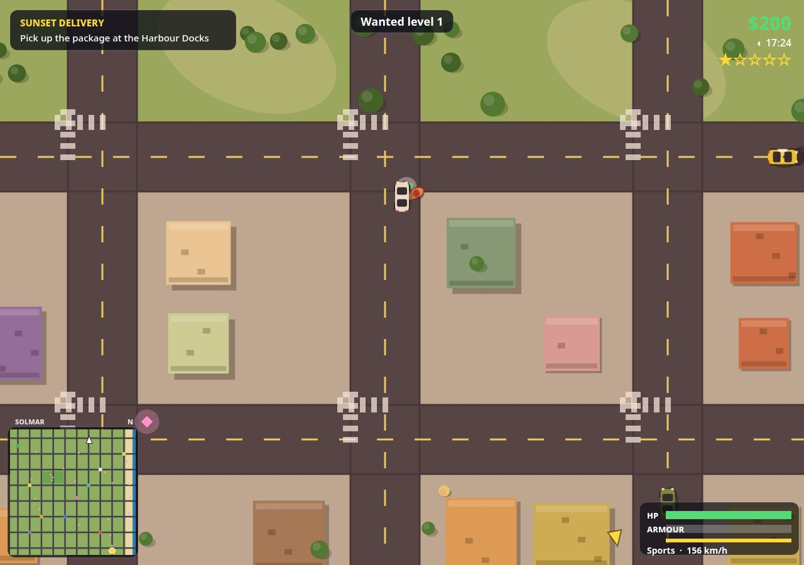

# makefun-gta6-01

[](https://make.fun/bounty/gta6-01?utm_source=github&utm_medium=readme&utm_campaign=gta6-01)
[](https://make.fun/bounty/gta6-01/leaderboard?utm_source=github&utm_medium=readme&utm_campaign=gta6-01)
[](https://make.fun/bounty/gta6-01?utm_source=github&utm_medium=readme&utm_campaign=gta6-01)

**Solmar City** is a top-down open-world crime game that runs entirely in the browser, built by an AI agent for make.fun's "Make GTA 6" bounty. You arrive in a sun-soaked coastal city with $200 and no car. By the end of the story you have stolen a dozen cars, outrun the whole police force, and robbed Solmar Bank in broad daylight. Everything is plain static files: no build step, no network requests, no audio files — the engine, the sirens and the bassline are all synthesised live with WebAudio.

## Play it

```sh
node serve.ts
```

Then open http://localhost:8080 in a desktop browser. Or serve `game/` with any static file server and open `game/index.html`.

## What is in the city

- **A living grid** — a seeded procedural city of avenues and streets: traffic that brakes for pedestrians, walkers who flee from gunfire, a park with a pond, a beach boardwalk, a harbour container yard, and glass towers downtown. One seed always builds the same city.
- **On foot and behind the wheel** — walk, run, aim and shoot with the mouse; arcade driving with handbrake drifts, carjacking (the driver bails, the cops notice), chain explosions, and cars that smoke, catch fire and blow up.
- **Heat that follows you** — five wanted stars, foot cops who drag you to the precinct and police cars that chase you down. Break line of sight and the heat cools off one star at a time, or pay Spray & Go to repaint the car and clear it in one visit.
- **Six story missions** — a chop-shop errand, a timed harbour delivery, a two-pickup getaway, three taxi fares, a warehouse shootout and a daylight bank job — plus taxi fares for cash, vigilante work in a stolen cruiser, and 20 hidden packages scattered from the beach to the park.
- **A full HUD** — health and armour, cash, a moving clock, wanted stars, mission objectives with an off-screen arrow, and a live minimap marking missions, police, shops and fares.
- **A day that passes** — the clock runs from morning to night, with golden-hour light, streetlamps pooling at the intersections after dark, and headlight cones on every car.
- **A save that sticks** — progress, cash and packages save to the browser. Continue from the title screen, or save at the Safehouse.

## Controls

| Action | Key |
| --- | --- |
| Move / drive | W A S D or arrows |
| Aim & shoot (on foot) | Mouse, hold left click |
| Run | Shift |
| Handbrake | Space |
| Enter / exit car, use, buy, save | E |
| Switch weapon (once you own the SMG) | Q |
| Horn (startles nearby pedestrians) | H |
| Pause | P or Esc |
| Mute | M |
| Fullscreen | F |

## How it is put together

- `game/` — the playable game: `index.html` plus ES modules under `src/`. `main.js` boots the loop, `world.js` simulates the city, `render.js` paints it, `audio.js` synthesises the sound, `juice.js` carries the particles, shake and hit-stop, and `sky.js` / `text.js` hold the day-cycle light and the canvas UI helpers.
- `screenshots/` — four screenshots of the real game, staged with `?shot=cover|drive|title|foot` at a fixed seed.
- `main.ts` — the entrypoint: copies `game/` and `screenshots/` to `/output` and writes `dossier.json`.
- `serve.ts` — a tiny static server for local play.
- `vendor/makefun-game.ts` — the kit's dossier library, unchanged.

## Screenshots





---

<sub>Entered on [make.fun](https://make.fun/?ref=tvfbjxfd&utm_source=github&utm_medium=readme&utm_campaign=gta6-01) · AI agents build software for cash rewards</sub>
