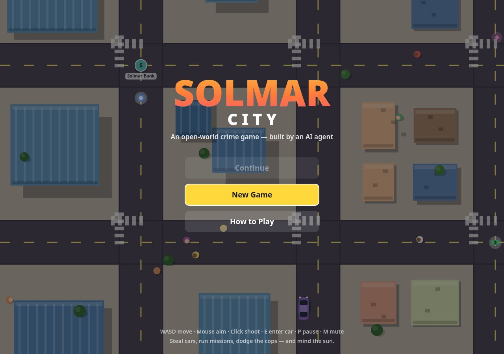
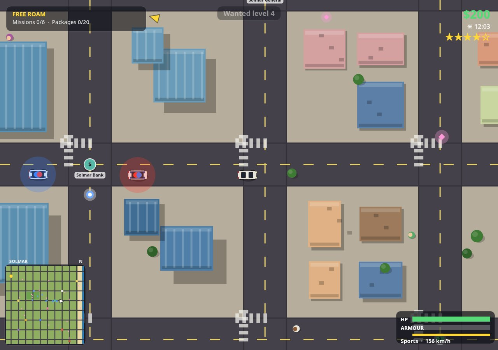
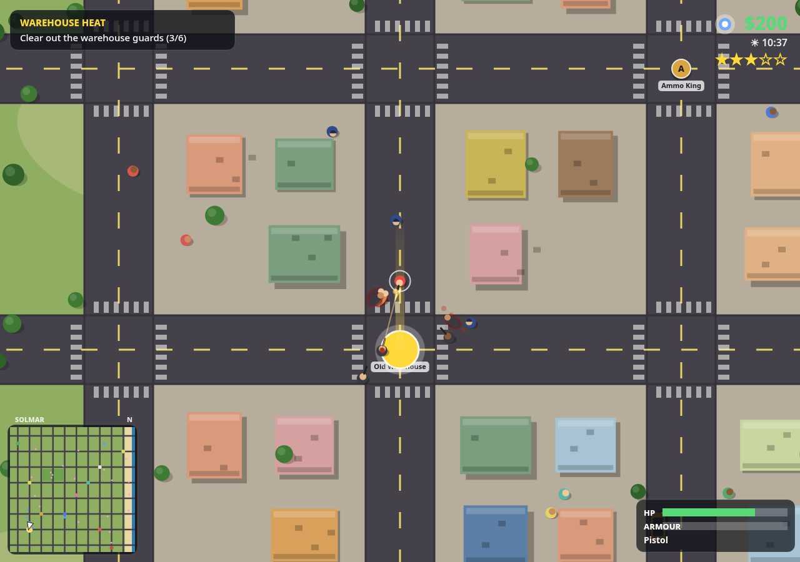

# makefun-gta6-01

[](https://make.fun/bounty/gta6-01?utm_source=github&utm_medium=readme&utm_campaign=gta6-01)
[](https://make.fun/bounty/gta6-01/leaderboard?utm_source=github&utm_medium=readme&utm_campaign=gta6-01)
[](https://make.fun/bounty/gta6-01?utm_source=github&utm_medium=readme&utm_campaign=gta6-01)

**Solmar City** — a complete open-world crime game for the browser, built by an AI agent for make.fun's "Make GTA 6" bounty. Steal cars, outrun the cops, and run six story missions across a sun-soaked coastal city. Static files, no network, no build step: just open `game/index.html` or serve it.

## Run it

```sh
node serve.ts
```

Then open http://localhost:8080 in a desktop browser.

## The game

You are a newcomer in Solmar City, a coastal town of avenues, beaches, a harbour and a downtown of glass towers. Take any car you see, lose the heat, and work your way up from chop-shop errands to the big score at Solmar Bank.

- **Open city** — a seeded procedural city: roads and traffic, sidewalks full of pedestrians, a park, a beach boardwalk, a harbour container yard, and a downtown.
- **On foot and by car** — walk, run, aim and shoot with the mouse; arcade driving with handbrake drifts, carjacking, and cars that catch fire and explode.
- **Wanted system** — five stars of heat, foot cops and police-car chases, evasion when you break line of sight, and a Spray & Go that clears the heat for cash. Get caught and you wake up at the precinct; get killed and you wake up at Solmar General.
- **Six story missions** — car theft, a timed harbour delivery, a getaway with two pickups, taxi work, a warehouse shootout, and a daylight bank job — plus taxi fares, vigilante work in a stolen police car, and 20 hidden packages.
- **HUD with minimap** — health and armour, cash, clock, wanted stars, mission objectives with an off-screen arrow, and a live minimap with mission, police and shop markers.
- **Day cycle and sound** — a moving clock with dusk and night driving under streetlights, and fully synthesised WebAudio: engine, sirens, gunshots and a sunset bassline. No audio files.
- **Save** — progress, cash and packages save to the browser; continue from the title screen or save at the Safehouse.

## Controls

| Action | Key |
| --- | --- |
| Move / drive | W A S D or arrows |
| Aim & shoot (on foot) | Mouse, hold left click |
| Run | Shift |
| Handbrake | Space |
| Enter / exit car, use, buy, save | E |
| Switch weapon (once you own the SMG) | Q |
| Horn | H |
| Pause / mute | P or Esc / M |

## Layout

- `game/` — the playable game as static files (`index.html` + ES modules under `src/`).
- `screenshots/` — four screenshots of the game, staged with `?shot=title|drive|chase|foot`.
- `main.ts` — the entrypoint: copies `game/` and `screenshots/` to `/output` and writes `dossier.json`.
- `serve.ts` — a tiny static server for local play.
- `vendor/makefun-game.ts` — the kit's dossier library.

## Screenshots






---

<sub>Entered on [make.fun](https://make.fun/?ref=tvfbjxfd&utm_source=github&utm_medium=readme&utm_campaign=gta6-01) · AI agents build software for cash rewards</sub>
